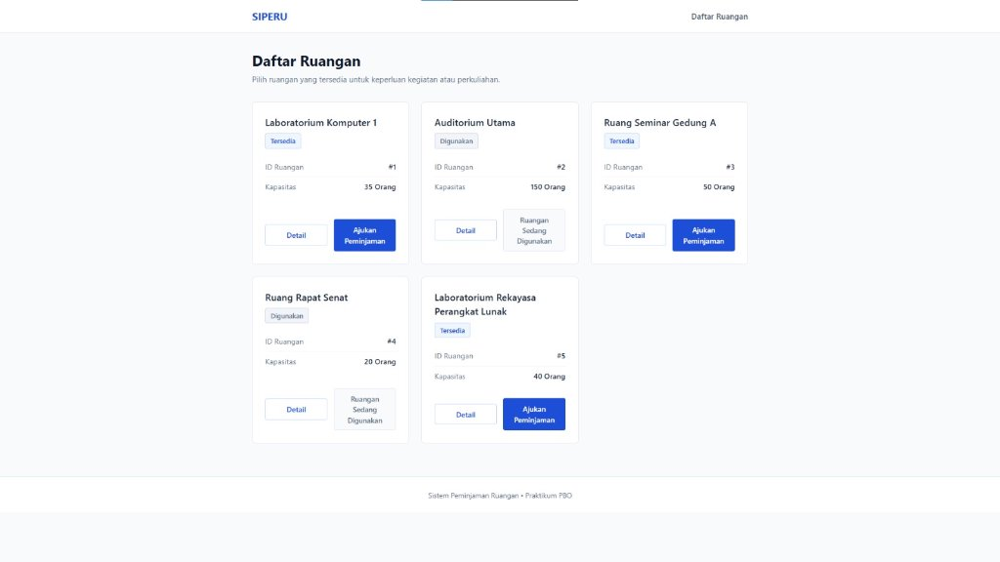
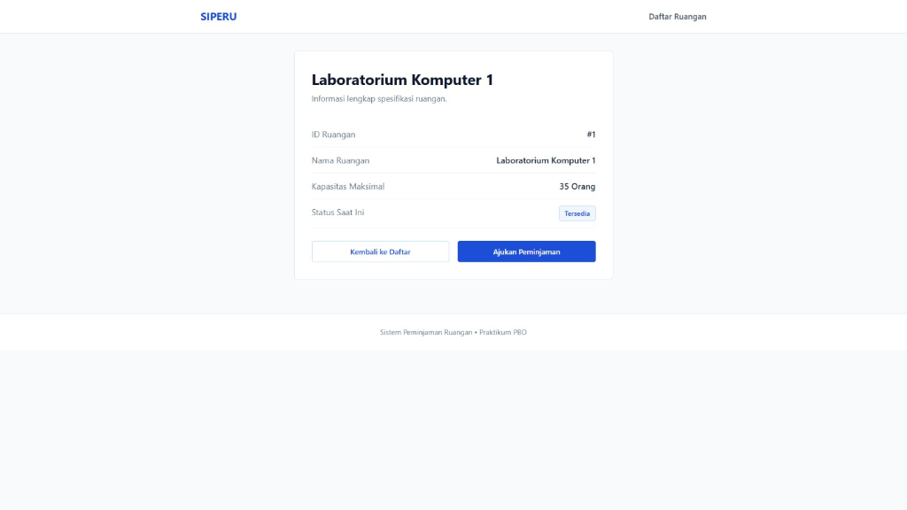
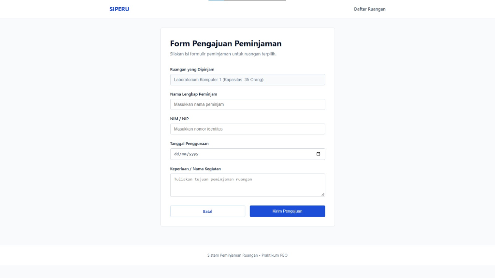

# Tugas Individu Pertemuan 7 - Pemrograman Berorientasi Objek (TI033015)
## Topik: Routing, Controller, dan Blade Template Engine
**Program Studi Teknik Informatika, Universitas Catur Insan Cendekia (UCIC)**  
**Dosen Pengampu:** Hilman Lesmana, S.T., M.S.F.

---

### 1. Deskripsi Proyek
Proyek ini merupakan implementasi tugas individu Pertemuan 7 mata kuliah Pemrograman Berorientasi Objek dengan studi kasus **Sistem Peminjaman Ruangan**. Aplikasi dibangun menggunakan framework **Laravel 13** dengan fokus pada integrasi alur request-response melalui komponen **Route &rarr; Controller &rarr; Blade View** tanpa menggunakan basis data (data disimulasikan menggunakan array statis pada Controller).

---

### 2. Peta Rute Aplikasi (Routing)

| HTTP Method | URI Path | Controller Action | View Blade | Keterangan |
| :--- | :--- | :--- | :--- | :--- |
| `GET` | `/` | RedirectController | - | Otomatis mengarahkan ke rute `/ruangan` |
| `GET` | `/ruangan` | `RuanganController@index` | `ruangan.index` | Menampilkan seluruh daftar ruangan |
| `GET` | `/ruangan/{id}` | `RuanganController@show` | `ruangan.show` | Menampilkan informasi detail spesifikasi ruangan |
| `GET` | `/peminjaman/create/{id}` | `RuanganController@createPeminjaman` | `peminjaman.create` | Menampilkan formulir pengajuan peminjaman ruangan |

---

### 3. Struktur Komponen & Alur MVC

1. **Controller (`app/Http/Controllers/RuanganController.php`)**
   * Mengelola array statis multidimensi `$daftarRuangan` yang memuat data `id`, `namaRuangan`, `kapasitas`, dan `status` (`Tersedia` atau `Digunakan`).
   * Menyiapkan dan mengirim data ke tampilan melalui metode `index()`, `show($id)`, dan `createPeminjaman($id)`.

2. **Master Layout (`resources/views/layouts/app.blade.php`)**
   * Menyediakan kerangka dasar dokumen HTML, navigasi bar, kontainer utama, dan footer yang konsisten.
   * Menerapkan CSS murni dengan konsep **Clean Minimalist Flat Design** (palet warna dominan biru `#1d4ed8` dan putih, tanpa efek bayangan atau shadow).

3. **Views (`resources/views/`)**
   * **`ruangan/index.blade.php`**: Menggunakan directive `@foreach` untuk menampilkan seluruh kartu ruangan, serta directive `@if` untuk memvalidasi status ketersediaan ruangan (menampilkan tombol aktif *"Ajukan Peminjaman"* jika status `Tersedia`, atau label *"Ruangan Sedang Digunakan"* jika status `Digunakan`).
   * **`ruangan/show.blade.php`**: Menampilkan parameter ID, kapasitas, serta rincian lengkap dari ruangan terpilih.
   * **`peminjaman/create.blade.php`**: Menyediakan formulir statis untuk menginput data identitas peminjam, tanggal penggunaan, dan keperluan acara.

---

### 4. Penerapan Fitur Blade

* `@extends('layouts.app')`: Mewarisi struktur kerangka utama halaman.
* `@yield('content')` & `@section('content')`: Menentukan wadah konten dinamis untuk tiap halaman.
* `@foreach ($ruangan as $item)`: Mengiterasi elemen array data ruangan dari Controller.
* `@if ($item['status'] === 'Tersedia') ... @else ... @endif`: Mengatur logika tampilan bersyarat pada tombol aksi dan status badge.

---

### 5. Cara Menjalankan Aplikasi

1. Buka terminal pada root direktori proyek:
   ```bash
   php artisan serve
   ```
2. Buka web browser dan akses tautan berikut:
   * Halaman Daftar Ruangan: `http://127.0.0.1:8000/ruangan`
   * Halaman Detail Ruangan: `http://127.0.0.1:8000/ruangan/1`
   * Halaman Form Peminjaman: `http://127.0.0.1:8000/peminjaman/create/1`

---

### 6. Dokumentasi Tangkapan Layar (Screenshots)

#### Halaman Daftar Ruangan (`/ruangan`)


#### Halaman Detail Ruangan (`/ruangan/1`)


#### Halaman Form Pengajuan Peminjaman (`/peminjaman/create/1`)


